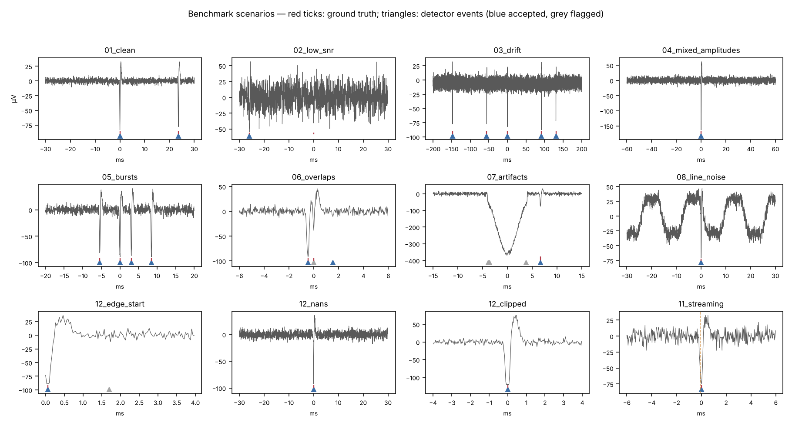
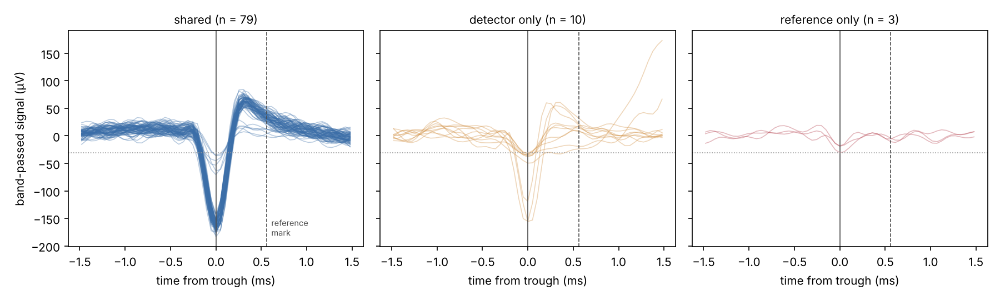
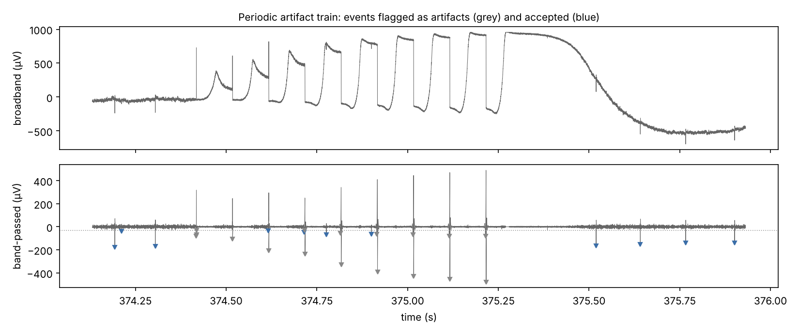

# Spike detection for extracellular recordings

*Minka Dubourg, August 2026*

Threshold-based spike detection looks simple: band-pass the signal, estimate the noise, mark where the signal crosses k times the noise, align each crossing to its trough. Most of the difficulty lies in what real recordings add on top: drift, mains hum, artifacts, saturation, dropped samples, bursts, colliding waveforms, sampling-rate changes and streaming input. Another difficulty is that "ground truth" is often only another detector's output.

This project builds a detector around those problems. It has five parts:
- **`spikedet`, a detector** that flags events instead of silently dropping them.
- **A benchmark** of 18 synthetic recordings, each isolating one failure mode, run by the tests.
- **A streaming version** that reproduces the offline causal detector sample for sample.
- **An audit of a reference detector** on a real intracortical recording.
- **Analyses of six other kinds of electrophysiology data**, each scored against ground truth: LFP, spike trains, waveform snippets, binned counts, neural-behavioural decoding and multichannel quality control.

<p align="center"></p>

## Main results

### 1. Auditing a reference detector on a real recording

The recording is 12 s of single-channel broadband intracortical signal at 19.6 kHz. A reference detector's output came with it. That output is not ground truth: it is another detector, so the comparison measures agreement, and every disagreement was checked on the signal. The recording is not redistributable, so only the results are included here.

- **The reference uses a fixed timing convention, which has to be removed before comparing.** It marks every spike 10 or 11 samples (0.51–0.56 ms) after the trough, on the rising phase of the waveform. The comparison removes this offset in the scoring code; the detector keeps reporting the true trough.
  - An earlier version of this detector had absorbed the convention instead: it snapped its output one sample late so that it would match the reference. That shifted the timing at every other sampling rate. The convention now lives only in the scoring.
- **Agreement:** 79 events are found by both; 10 only by this detector; 3 only by the reference.

| category | n | what the signal shows |
|---|--:|---|
| only this detector, large | 3 | troughs of −119 to −156 µV, 3.8–5 × the threshold, with the same shape as the shared spikes: spikes the reference missed |
| only this detector, on the artifact train | 2 | lobes next to stimulation-like transients |
| only this detector, near threshold | 5 | 1.0–1.23 × the threshold: ambiguous |
| only the reference | 3 | two troughs at 0.6 × the threshold (≈ 2.7 σ, inside the noise) and one at the threshold; one sits in an amplifier-saturation recovery |

<p align="center"></p>

- **The recording contains a 10 Hz train of step artifacts.** The DC offset grows until the signal is pinned near +955 µV for about 0.15 s, which looks like amplifier saturation. The band-pass turns each step into spike-like lobes of up to −480 µV. The detector flags 17 events as artifacts, all of them on this train.

<p align="center"></p>

- **The noise is not stationary.** Its σ falls from 7.5 to 4.9 µV over the last 2 s. A single threshold for the whole recording is therefore set by the noisier part. A per-window threshold is available (`noise_window_s`).
- **Filter settings were explored, not tuned to the reference.** Raising the low cut from 150 to 500 Hz raises the spike SNR from 12.4 to 15.2 dB, yet agreement with the reference barely moves (79–80 shared). Choosing settings by agreement would only teach the detector to copy the reference's misses.

### 2. Failure-mode benchmark

Each scenario is rebuilt from a fixed seed. Accepted events are scored against ground truth with one-to-one matching within ±1 ms. Two profiles are run:
- **offline:** zero-phase filtering, noise estimated over the whole recording;
- **streaming:** causal filtering, noise estimated on the first 0.25 s, 1.5 ms refractory period, input fed in chunks.

| scenario | what it tests | offline TP / FP / FN | streaming TP / FP / FN |
|---|---|:--:|:--:|
| 01 clean | sanity | 12 / 0 / 0 | 12 / 0 / 0 |
| 02 low SNR | 40 µV spikes in 15 µV noise | 20 / 0 / 5 | **4 / 1 / 21** |
| 03 drift | slow baseline wander | 20 / 1 / 0 | 20 / 0 / 0 |
| 04 mixed amplitudes | 25, 70, 160 µV units | 30 / 1 / 0 | 27 / 0 / 3 |
| 05 bursts | 3–6 ms intervals | 26 / 0 / 0 | 26 / 0 / 0 |
| 06 overlaps | collisions 0.2–0.8 ms apart | 17 / 1 / 6 | 17 / 0 / 6 |
| 07 artifacts | broad 300–500 µV events, both polarities | 20 / 1 / 0 | 20 / 0 / 0 |
| 08 line noise | 60 + 180 Hz hum | 20 / 0 / 0 | 20 / 0 / 0 |
| 09 multichannel | artifact shared by 4 channels | 60 / 0 / 0 | – |
| 10 sampling rate | same recording at 20 and 30 kHz | 30 / 1 / 0 | 30 / 0 / 0 |
| 11 streaming | spike across a chunk boundary | 18 / 0 / 0 | 18 / 0 / 0 |
| 12 edge cases | empty, noise only, truncated at either end, NaN gaps, clipping | 14 / 0 / 0 | 14 / 0 / 0 |
| **total** | | **287 / 5 / 11** | **208 / 1 / 30** |

Full per-scenario results, including the flag checks, are in [`results/benchmark.csv`](results/benchmark.csv). Notes on individual rows:
- **06 overlaps:** the 6 misses are collisions less than 0.8 ms apart. A threshold detector sees one merged event there; separating them needs template matching.
- **02 low SNR:** the 5 offline misses are expected at a peak SNR of 2.7 with k = 4.5.

### 3. Streaming detector

The streaming detector keeps the filter state between chunks and emits an event only once enough signal has arrived after it. Every flag depends on a bounded neighbourhood of its event, and the detector waits for that neighbourhood to be complete. As a result, its output is identical to the offline detector in causal mode: for chunks of 1, 37, 1000 or 4096 samples, and on artifacts, bursts, NaN gaps and truncated edge spikes. The tests check this field by field. Latency is 30 ms with the default settings (most of it from the 20 ms baseline window of the artifact test) and memory is bounded.

The cost is sensitivity. A causal band-pass moves the spike's energy into its positive overshoot. On the benchmark waveform, the trough falls from 5.5 σ to 2.9 σ of the filtered noise, while the overshoot reaches 4.4 σ. At low SNR, recall drops from 0.80 offline to 0.16. A real-time detector should therefore threshold the overshoot or use a matched filter (see next steps).

### 4. What the benchmark exposed

- **Broad artifacts leave spike-sized lobes in the spike band.** The 300 Hz high-pass removes most of an 8 ms artifact. What remains are lobes of −13 to −26 µV at its edges, 0.07–0.3 ms wide, which look just like a 25 µV unit. A polarity test misses the negative artifacts, and amplitude and width cannot separate them from small units either.
  - The fix looks at the raw signal: an event is an artifact if it lies on a broad excursion more than 3 × its own amplitude.
  - This brought the false positives on `07_artifacts` from 3 to 1, without losing a spike that sits 2.7 ms after an artifact.
- **Very large spikes ring.** A 500 µV spike produces filter lobes 2–3 ms away that cross a low threshold. Troughs more than 10 × smaller than a neighbour within 3 ms are now flagged as duplicates.
- **Truncated spikes at the start or end of a recording were thrown away.** They were labelled artifacts because the polarity window was cut off. They are now kept and flagged `edge`. Clipped spikes are kept and flagged `clipped`.
- **A naive matching rule overstates performance.** Nearest-within-window matching lets one detection claim two true spikes. The scorer solves an assignment problem instead (`spikedet.evaluate.match`).
- **The tests found two bugs in the synthetic data:**
  - the burst generator placed true spikes 1 and 6 samples apart, which no neuron can do;
  - the streaming generator computed a chunk-boundary shift but never applied it.

  Both are fixed and covered by regression tests.

### 5. Other kinds of electrophysiology data

Each dataset carries ground truth for several problems at once. All detection is data-driven: labels are read only for scoring. The full numbers are in [`results/modalities.json`](results/modalities.json).

| data | analysis | result |
|---|---|---|
| LFP, 1 kHz | notch 60/120 Hz; variance-based artifact detection; gamma bursts by hysteresis on the Hilbert envelope; phase-amplitude coupling (Tort MI) | hum −61 dB; artifacts recall 1.0, precision 0.76; bursts F1 0.75; coupling significant within bursts (MI 0.018, p = 0.005 against shifted surrogates) but 2.6 × weaker over the whole recording |
| spike trains | ISI, refractory violations, PSTH, cross-correlogram with jitter surrogates | 4 / 4 injected violations, no false flag; evoked rate 4.7 → 18.3 Hz; 12 synchronous pairs within 2 ms against 4.1 expected (p = 0.005) |
| waveform snippets | shape-based artifact rejection, PCA + k-means | 10 / 10 artifacts rejected without labels; the rare unit is separated, while the drifting unit merges with the unit whose amplitude it drifts into (ARI 0.22) |
| binned counts | Fano factor, dead/NaN channels, non-stationarity | dead and overdispersed channels found (Fano 2.74, unchanged at 200 ms bins); 2 s NaN gap excluded rather than counted as zeros; rate ramp 5.8 → 20.1 Hz |
| neural + behaviour | ridge decoder, lag sweep, blocked cross-validation | held-out R² 0.25 against −0.27 for the mean; lag optimum 80–100 ms (true 100); see the note below the table |
| 8-channel array | noise-based health, mid-session degradation, crosstalk, median referencing | 8 / 8 channel states correct, against 5 / 8 for the metadata; ch7 carries a 0.31 × copy of ch6; referencing cuts low-frequency inter-channel correlation from 0.97 to −0.11 |

Notes on the neural + behaviour decoder:
- **Splitting by block fails because of the data, not the model.** Training on one task block and testing on the other gives R² = −1.5, because the two blocks cover different movement directions (−18…42° against 33…72°).
- **Speed saturates outside the training range.** The fast rotation is decoded at 87 against a true 250, which is the saturation built into the tuning.

## Design

```
raw ─ gap repair ─ band-pass ─ MAD threshold ─ crossings ─ trough alignment ─ flags ─ event table
                   (zero-phase      (global, per-window       (true trough +
                    or causal)       or calibration)           sub-sample offset)
```

- **Events are flagged, never dropped.** Each event carries flags: `artifact`, `dropped_sample`, `refractory_duplicate` and `common_artifact`, which reject it, plus `edge` and `clipped`, which only inform. `accepted` is the default selection. A downstream user can audit the choice or make a different one.
- **One schema for every input.** Column names and dtypes are the same for empty, all-NaN, noise-only and normal recordings, so the next stage never receives an untyped table.
- **Durations are in milliseconds, never samples**, so one configuration works at any sampling rate. The sampling rate is given or inferred from timestamps, never hard-coded.
- **The event index is the true trough** of the filtered signal, plus a parabolic sub-sample offset. Any other timing convention, such as a reference detector's, belongs in the scoring code.
- **Multichannel:** each channel is detected separately. Events that coincide (±0.5 ms) on at least 75 % of channels are marked `common_artifact`, since a spike is local and a reference glitch is not.

## Testing

The 97 tests run in about 30 s, and CI runs them on Python 3.10 and 3.12.

- **Each stage** against known answers:
  - MAD on Gaussian noise with outliers;
  - the rolling threshold following a noise step;
  - a parabola with its minimum at 50.3;
  - crossings in a recording that starts below threshold;
  - the width cap.
- **Invariances:**
  - the same events in seconds at 20 and 30 kHz;
  - scaling the signal leaves the events unchanged;
  - shifting the recording shifts the events;
  - the event index is a local minimum of the filtered signal.
- **The output schema** for empty, all-NaN, too-short and noise-only input.
- **The scorer:**
  - one detection can never claim two references;
  - the assignment beats greedy matching;
  - the convention shift works;
  - the result does not depend on input order.
- **Streaming equals offline causal** for chunk sizes from 1 to the full recording, with bounded latency and memory.
- **The benchmark as a regression test.** Each scenario has an expected minimum recall and maximum false positives. Known limitations (collisions, causal low SNR) are written into the expectations with their reason rather than skipped.
- **The scenarios themselves:**
  - they are deterministic;
  - true spikes respect a refractory period;
  - the streaming case really straddles a chunk boundary;
  - ground truth lies inside the recording.

## Usage

```bash
pip install -e ".[analysis,dev]"
pytest
python -m spikedet.benchmark                      # -> results/benchmark.csv
python analyses/plot_scenarios.py                 # -> figures/scenarios.png
python modalities/generate.py && python modalities/analyze.py
python analyses/reference_comparison.py --data <recording.csv>   # needs your own copy of the recording
```

```python
from spikedet import DetectorConfig, detect, detect_multichannel
from spikedet.streaming import StreamingDetector

events = detect(voltage, time_s=time_s)                      # fs inferred from timestamps
spikes = events[events.accepted]

det = StreamingDetector(fs=30000, config=DetectorConfig(noise_calibration_s=0.5))
for chunk in source:
    new_events = det.process(chunk)
new_events = det.flush()
```

## Repository layout

```
spikedet/
  config.py      DetectorConfig (all durations in ms)
  signal.py      gap repair, filters, noise and threshold, crossings, trough alignment
  detector.py    offline and multichannel detection, flags
  streaming.py   chunked causal detector
  events.py      event-table schema
  evaluate.py    one-to-one matching
  scenarios.py   the 18 failure-mode recordings
  benchmark.py   runs every scenario for a configuration
analyses/        reference_comparison.py, plot_scenarios.py
modalities/      generate.py (other data types), analyze.py
tests/  results/  figures/
```

## Limitations and next steps

- **Collisions.** Overlapping spikes less than 1 ms apart are merged into one event. Template matching or deconvolution is the next step.
- **The causal detector is insensitive at low SNR.** Thresholding the positive overshoot, or a matched filter on the causally filtered waveform, should recover most of the loss.
- **No spatial detection.** Multichannel detection is per channel, apart from shared-artifact rejection. Spatial detection and sorting across neighbouring electrodes are not implemented.
- **No file formats or scale.** Reading standard formats such as NWB, and chunked storage for long multichannel recordings, are not implemented yet. The streaming detector already gives a constant-memory path for them.
- **No automatic rail detection when streaming.** Clipping is flagged in streaming mode only when the amplifier rail is configured; offline, it is detected from the data.

## Credits

The failure-mode scenarios and the six other data types were specified by me. The synthetic-data generators were written with an AI assistant. The voltage scenarios were later rewritten into `spikedet/scenarios.py`, where the two generator bugs above were fixed. The real recording and its reference detector output come from a third party and are not distributed.

## References

1. R. Quian Quiroga, Z. Nadasdy, Y. Ben-Shaul, "Unsupervised spike detection and sorting with wavelets and superparamagnetic clustering," *Neural Computation* 16, 1661–1687, 2004 (MAD noise estimate).
2. A. B. L. Tort, R. Komorowski, H. Eichenbaum, N. Kopell, "Measuring phase-amplitude coupling between neuronal oscillations of different frequencies," *J. Neurophysiol.* 104, 1195–1210, 2010.
3. H. W. Kuhn, "The Hungarian method for the assignment problem," *Naval Research Logistics Quarterly* 2, 83–97, 1955.
4. G. Buzsáki, C. A. Anastassiou, C. Koch, "The origin of extracellular fields and currents — EEG, ECoG, LFP and spikes," *Nat. Rev. Neurosci.* 13, 407–420, 2012.
